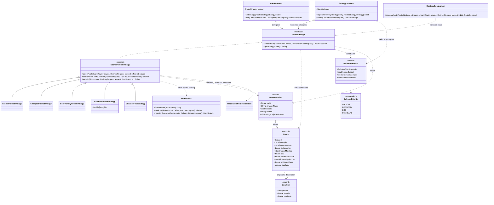
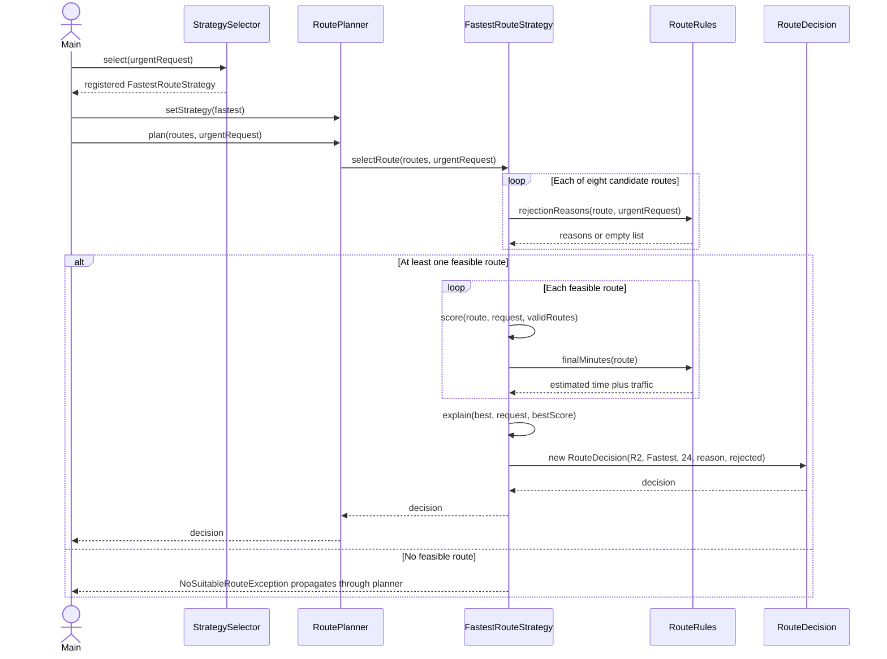

# UML diagrams

## Class diagram

## Sequence diagram

Scenario: an urgent request with budget 6000 KZT and deadline 30 minutes. The planner already exists. `selectRoute` is inherited by FastestRouteStrategy from ScoredRouteStrategy.

